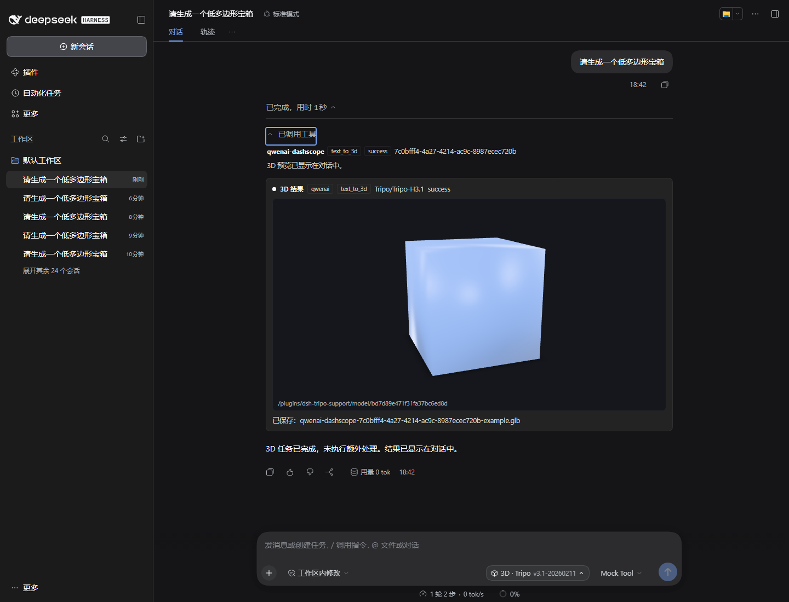
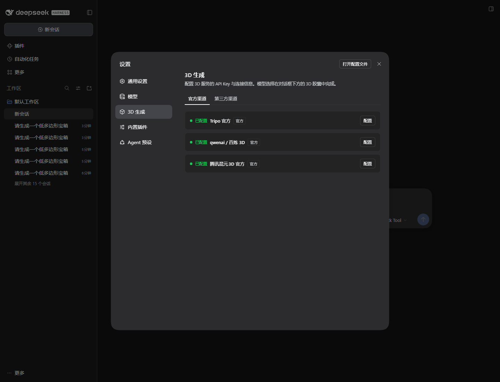
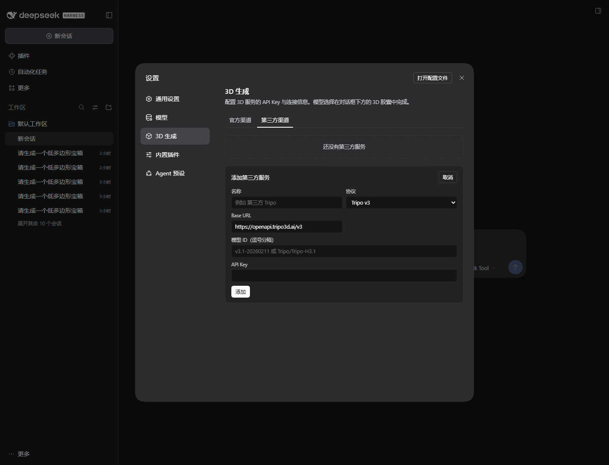
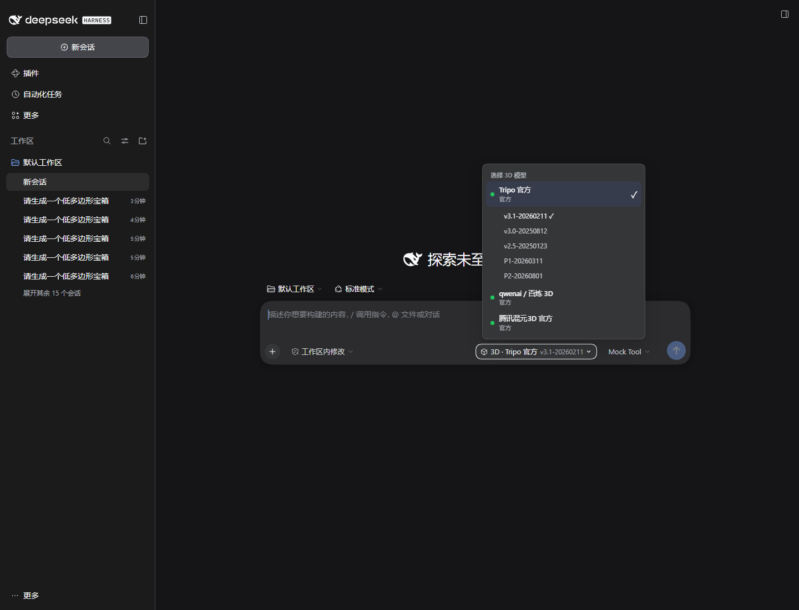

# dsh-tripo-support

[](LICENSE)
[](https://github.com/deepseek-ai)

**让 DeepSeek Harness（DSH）直接管理并调用 Tripo、Meshy、Hyper3D、腾讯混元3D 以及兼容的第三方异步 3D 生成服务。**

Tripo, Meshy, Hyper3D and Tencent Hunyuan3D async 3D providers for DeepSeek Harness — configure keys in **Settings → 3D generation**, pick a 3D model in the composer, and let the agent generate, preview and post-process 3D assets.



## 特性

- **独立设置页**：在「设置 → 3D 生成」中管理官方与第三方服务，和 DSH 模型配置界面分开。
- **独立 3D 模型选择器**：对话框工具条中的 `3D · provider` 胶囊，不覆盖 DSH 原生 LLM 模型选择器。
- **五套协议适配**：
  - Tripo 官方 v3（Bearer API Key）
  - Meshy 官方（Bearer API Key）
  - Hyper3D / Rodin 官方（Bearer API Key）
  - qwenai / DashScope 3D（**第三方渠道**，Tripo 模型；`X-DashScope-Async: enable`，自动推导 `/api/v1/tasks/{id}`）
  - 腾讯混元3D 官方（SecretId + SecretKey + TC3-HMAC-SHA256）
  - 任何兼容上述协议的第三方网关，只需自定义 Base URL、key 和模型名
- **完整操作目录**：文生/图生/多视图 3D、文生图/图生图/多视图编辑、贴图、拆件/智能分割、拓扑/减面、UV、补洞、格式转换、可绑骨检查、自动绑骨、动画重定向、Gaussian Splat、混元3D 人物/动作/组件等。
- **异步任务**：创建 → 轮询 → 下载到当前 Session 的 `3d-output/`；支持对话内实时进度。
- **对话内 3D 预览**：生成完成后在对话中自动出现独立的 `model-viewer` 结果卡片，无需展开工具调用。
- **批量与回调**：`batch_query_3d_tasks` 批量查询 Tripo 任务；Tripo Webhook 支持 HMAC-SHA256 校验。

## 截图

| 设置 → 3D 生成 | 第三方服务 |
|---|---|
|  |  |

| 对话框 3D 选择器 | 对话内预览 |
|---|---|
|  |  |

## 安装

更新日志见 [`CHANGELOG.md`](CHANGELOG.md)。
最新发布：https://github.com/OMEN111111/dsh-tripo-support/releases/tag/v0.1.2

要求：DeepSeek Harness Desktop `0.2.2-rc.2`（兼容 `>=0.2.2-rc.1 <0.3.0`）。

```powershell
# 建议先备份真实 profile
Copy-Item "$env:USERPROFILE\.dsh\profiles\desktop\cordis.patch.yml" `
  "$env:USERPROFILE\.dsh\profiles\desktop\cordis.patch.yml.bak-before-tripo"

# 从 GitHub 安装（仓库根已是 DSH 组合包）
dsh plugin --profile desktop add "https://github.com/OMEN111111/dsh-tripo-support.git"

# 或从本地仓库根目录安装
dsh plugin --profile desktop add "."

# 或从打包文件安装
dsh plugin --profile desktop add ".\dist\dsh-tripo-support-0.1.2.tgz"
```

安装后从托盘完整退出并重新打开 DSH。插件只会在 profile 的 bundle 列表中插入一行；密钥由 DSH 凭据服务保存。

## 配置

### Tripo 官方

| 字段 | 值 |
|---|---|
| 协议 | Tripo v3 |
| Base URL | `https://openapi.tripo3d.ai/v3` |
| API Key | `tsk_...` |
| 默认模型 | `v3.1-20260211` |

### Meshy 官方

| 字段 | 值 |
|---|---|
| 协议 | Meshy |
| Base URL | `https://api.meshy.ai` |
| API Key | `msy_...` |
| 默认模型 | `meshy-7.1` |

### Hyper3D 官方

| 字段 | 值 |
|---|---|
| 协议 | Hyper3D Rodin |
| Base URL | `https://api.hyper3d.com/api/v2` |
| API Key | Rodin API Key |
| 默认模型 | `Gen-2.5-Medium` |

### 腾讯混元3D 官方

| 字段 | 值 |
|---|---|
| 协议 | 腾讯混元3D（TI-3D） |
| Base URL | `https://ai3d.tencentcloudapi.com` |
| Region | `ap-guangzhou` |
| SecretId / SecretKey | 腾讯云 API 密钥 |
| 默认模型 | `3.1-pro` / `3.0-pro` / `rapid` |

### 第三方（qwenai / 百炼 DashScope）

qwenai/百炼的 3D 服务使用 Tripo 模型，因此在「第三方渠道」中作为预设提供：

| 字段 | 值 |
|---|---|
| 协议 | DashScope 3D |
| Base URL | `https://cn-beijing.maas.qianwenaiapi.com/api/v1/services/aigc/video-generation/3d-generation` |
| API Key | 平台 key |
| 模型示例 | `Tripo/Tripo-H3.1`、`Tripo/Tripo-Texture`、`Tripo/Tripo-Retopology`、`Tripo/Tripo-AnimationRetarget` |

查询地址自动推导为 `/api/v1/tasks/{task_id}`。

其他第三方服务可在「第三方渠道」中新增，自定义名称、协议、Base URL、模型 ID 和 key。若第三方使用完全不同的协议，可在 `plugin/lib/protocols.js` 中增加适配器。

## Agent 工具

| 工具 | 用途 |
|---|---|
| `list_3d_providers` | 列出服务、模型、操作、密钥状态 |
| `list_3d_tasks` | 列出本地最近任务 |
| `batch_query_3d_tasks` | 批量查询 Tripo 任务（最多 100 个） |
| `select_3d_model` | 经用户明确同意后切换当前 3D 厂商 / 模型 |
| `create_3d_task` | 创建异步任务，立即返回 `task_id`，用于实时进度/预览 |
| `get_3d_task` | 查询任务并可下载 |
| `wait_3d_task` | 轮询到完成并下载 |
| `run_3d_operation` | 一次完成任意操作 |
| `generate_3d` | 文生3D / 图生3D / 多视图便捷入口 |

工具结果包含 `provider`、`operation`、`taskId`、`status`，成功时带 `localFile`、`bytes`、`previewUrl`。

## 架构

```
plugin/index.js          Host 工具、Web 路由、任务生命周期
plugin/lib/protocols.js  Tripo / DashScope / 腾讯云协议适配与操作目录
plugin/lib/state.js      服务配置与 DSH 凭据引用
plugin/lib/tasks.js      异步任务记录、下载、预览注册
plugin/client.js         模型设置卡片、3D 选择器、工具卡片预览
plugin/assets/           model-viewer（Apache-2.0）
```

详见 [docs/ARCHITECTURE.md](docs/ARCHITECTURE.md)。

## 测试

- 隔离 DSH 端到端测试：独立 3D 设置页、官方/第三方渠道、独立 3D 选择器、Agent 工具调用、工具卡片轮询、对话内 GLB 预览。
- 协议目录静态检查：`node tests/protocols-smoke.mjs`，51 项（Tripo 18 / DashScope 13 / Tencent 10 / Meshy 8 / Hyper3D 2）。
- Tripo、DashScope、腾讯混元3D 的生成与后处理均通过本地 mock；腾讯云签名由 mock 重算验证。
- Tripo Webhook：有效签名 200，错误签名 400。
- 打包安装：`dist/dsh-tripo-support-0.1.2.tgz` 在 fresh profile 中安装并加载成功。

详见 [docs/TESTING.md](docs/TESTING.md) 与 [feasibility/REPORT.md](feasibility/REPORT.md)。

### 未覆盖

- 未使用真实付费 key 创建任务；真实 key 的最小联调需要低额度测试 key。
- 第三方 HY3D 若不是 DashScope 兼容协议，需要其接口样例增加适配器。
- Webhook 生产使用需要公网可达的 DSH 入口/隧道。

## 安全

- API Key、SecretId/SecretKey、Webhook Secret 只写入 DSH `credentials` 服务，不写入配置文件或日志。
- 模型预览路由只提供已注册的预览文件，不接受任意路径。
- 设置卡片的写 key 路由做同源检查；生产可切换为 DSH `remote.credentials` 通道。

## 许可

MIT，见 [LICENSE](LICENSE)。`@google/model-viewer` 使用 Apache-2.0，见 [plugin/assets/LICENSE-model-viewer](plugin/assets/LICENSE-model-viewer)。


