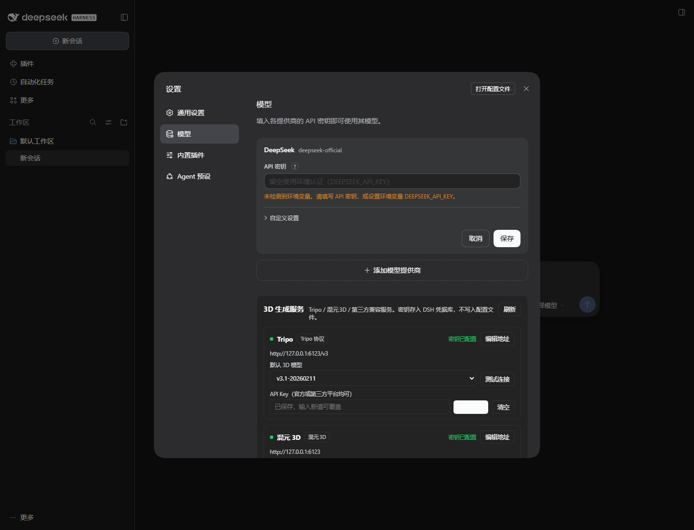
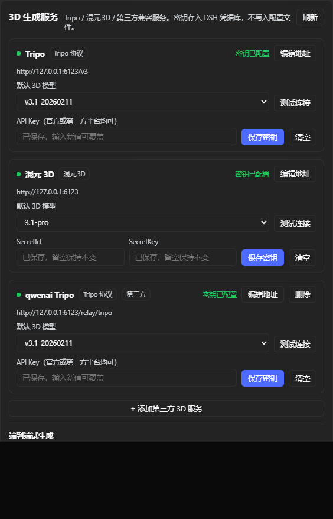
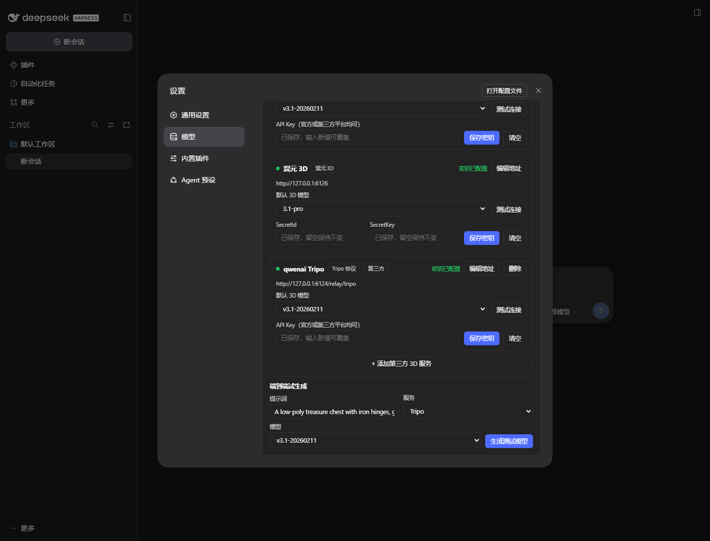
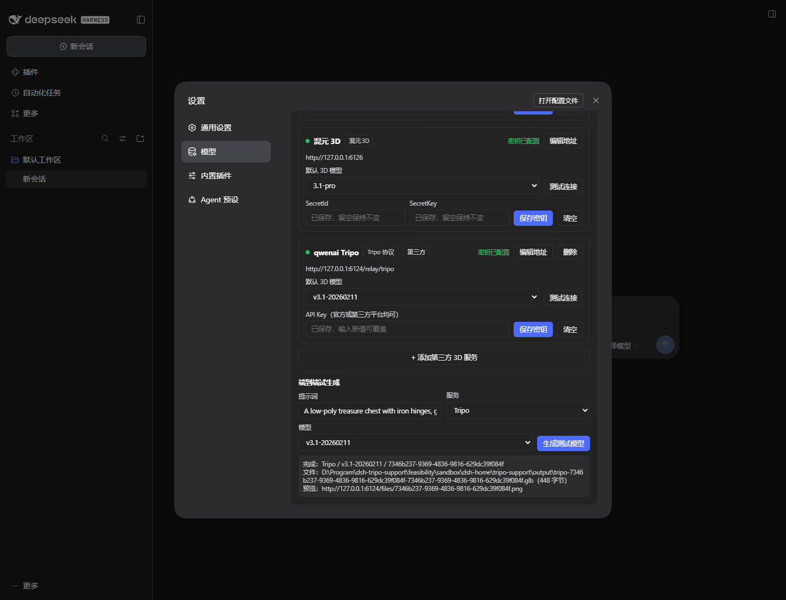
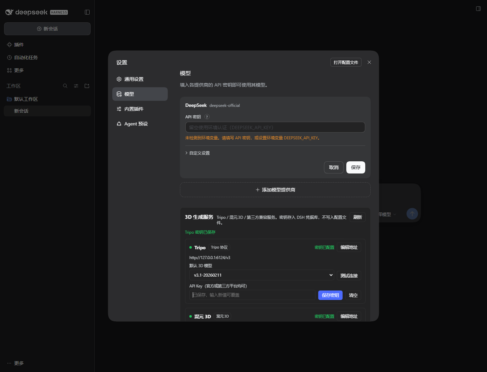
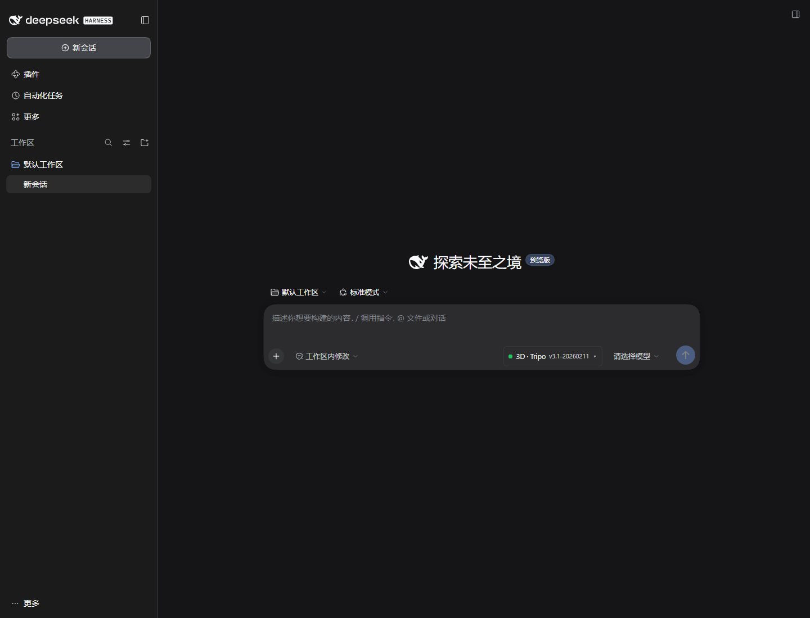
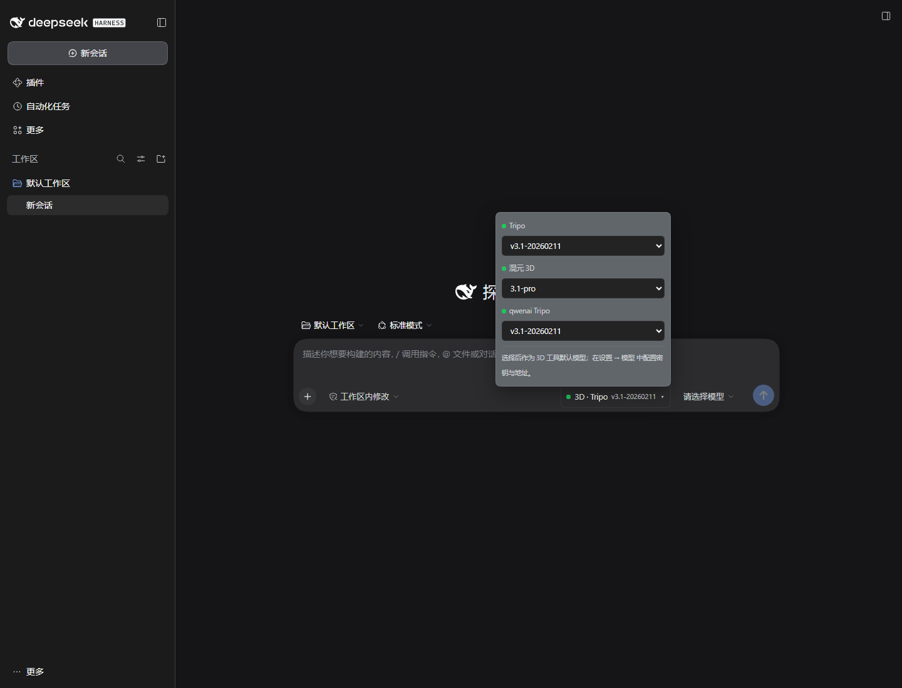

# DSH Tripo / 混元3D 插件可行性测试报告

> **后续状态（2026-11-12）**：用户已确认继续开发。正式插件位于 [`../plugin`](../plugin)，使用说明见 [`../plugin/README.md`](../plugin/README.md)。本报告保留为可行性阶段的原始记录；正式插件的实现与测试补充见 [`../docs/TESTING.md`](../docs/TESTING.md)。

- 测试日期：2026-11-11
- 测试宿主：DeepSeek Harness Desktop 0.2.2-rc.1
- 测试目录：`D:\Program\dsh-tripo-support\feasibility`
- 结论：**技术上可行，建议继续开发；但需要先确认一个关键产品决策——不要把 Tripo/HY3D 伪装成 DSH 的 LLM 聊天模型。**

---

## 0. 结论摘要

| 问题 | 结论 | 依据 |
|---|---|---|
| 能否在 DSH「设置 → 模型」里加入 3D 服务卡片？ | **可以** | `settings.models.footer` 插槽已在隔离实例中实际渲染并通过截图验证 |
| 能否像自定义模型 API 一样添加 key？ | **可以** | 卡片内 Base URL、API Key / SecretId+SecretKey、模型 ID 均可编辑；UI 保存 key 已实测成功，key 存入 DSH 凭据库 |
| 能否选择 Tripo / 混元3D 模型？ | **可以（独立 3D 选择器）** | 已在对话框工具条实现「3D · Tripo v3.1」胶囊和模型下拉，截图验证 |
| 能否跑通异步任务？ | **可以** | Tripo 创建任务 → 轮询 → 下载 GLB；混元3D 提交 → 轮询 → 下载 GLB；两者均端到端通过 |
| 第三方平台（如 qwenai）的 Tripo key 能否用？ | **可以，前提是协议兼容** | 已用自定义 Base URL + 第三方 key 的 mock relay 端到端验证；真实 qwenai 需要其接口样例确认 |
| 混元3D 官方是不是单 API Key？ | **不是** | 官方腾讯云要求 SecretId + SecretKey + TC3-HMAC-SHA256 签名；插件已按此实现并通过 mock 的服务端签名重算校验 |
| 能否在对话框内预览 3D 模型？ | **可以，底层已验证** | `model-viewer` 在浏览器中成功加载 GLB（`loaded=true`、`modelIsVisible=true`）；DSH 的 `tool.call.toolview` 插槽可用于对话卡片内嵌 |
| 能否支持 Tripo 的拆件、拓扑、贴图等全部功能？ | **可以，属于正式开发工作量** | 官方端点全部有对应 API；本次完成协议与架构验证，未逐项实现 |
| 能否直接塞进 DSH 原生 LLM 模型下拉框？ | **不建议** | DSH 的 `llm` 适配器契约是聊天流式模型（推理、工具调用、token 流）；3D 生成服务不具备这些能力，强行注册会破坏会话 |

---

## 1. 测试目标与边界

### 1.1 目标

1. 验证 DSH 是否允许第三方插件在「设置 → 模型」页面加入自己的服务卡片和密钥配置。
2. 验证 Tripo / 混元3D 的异步任务 API 能否被 DSH 插件调用、轮询、下载并保存到工作区。
3. 验证第三方 API Key（自定义 Base URL）路径。
4. 验证生成结果在 DSH 对话框内预览的技术可行性。
5. 全程不接触用户现有的 `desktop` profile，不冒损坏 DSH 的风险。

### 1.2 不在本次范围

- 不使用真实 Tripo / 腾讯云 key 创建付费任务；只做了无效凭据探测和本地 mock 端到端测试。
- 未逐项实现 Tripo/HY3D 的全部操作（拆件、拓扑、贴图、UV、绑定、动画等），只核对官方契约并给出覆盖矩阵。
- 未在真实 Agent 会话中触发 `generate_3d` 工具（隔离 profile 没配置可用 LLM）；生成逻辑与 UI 共用同一函数，已通过 UI 与 HTTP 调用验证。
- 未把 `model-viewer` 真正挂到 DSH 对话卡片中；只验证了渲染能力和插槽存在性。

---

## 2. 隔离测试环境

### 2.1 环境构成

| 项 | 值 |
|---|---|
| 独立 DSH_HOME | `D:\Program\dsh-tripo-support\feasibility\sandbox\dsh-home` |
| 独立 profile | `feas`（从官方 `web` 模板初始化） |
| 隔离 Web 端口 | `6130` |
| 本地 mock API | `127.0.0.1:6123 / 6124 / 6126 / 6127`（不同测试阶段） |
| 插件安装方式 | `dsh plugin --profile feas add <本地插件目录>`，profile 内为 `link:` 依赖 |
| 真实 profile | `C:\Users\31949\.dsh\profiles\desktop`，**未安装、未修改** |

### 2.2 隔离证明

- 插件只出现在 `feasibility\sandbox\dsh-home\profiles\feas\package.json` 的 `dsh.profile.bundles` 中。
- 真实 `desktop` profile 的 `package.json` 与 `cordis.patch.yml` 中没有 `dsh-tripo-support`。
- 测试结束后已停止隔离 DSH 与 mock 进程，6120/6123/6124/6125/6126/6127/6130 端口均已释放。
- 当前 6006 的 DSH 会话未受影响。

### 2.3 测试工具

- `node --check` 校验插件与 mock 语法。
- 无头 Edge + `puppeteer-core` 驱动隔离 Web UI，截图取证。
- `curl.exe` 对官方端点做无效凭据探测。
- 本地 mock 服务精确模拟 Tripo v3 与腾讯云 TI-3D 的响应结构；混元3D mock 会**重算 TC3 签名**，不是只检查 header 形状。

---

## 3. 已验证结果

### 3.1 DSH 模型设置页集成

`settings.models.footer` 是模型设置页在提供商行和「添加模型提供商」之后的扩展区。插件注册后，实际渲染出「3D 生成服务」卡片：

- 顶部：Tripo / 混元3D / 第三方兼容服务说明。
- 每个服务：密钥状态、Base URL、默认 3D 模型下拉、测试连接、API Key / SecretId / SecretKey 输入、保存密钥、清空。
- 第三方服务：额外「第三方」标签和删除按钮。
- 底部：「+ 添加第三方 3D 服务」表单和「端到端试生成」。

关键截图：











### 3.2 UI 密钥保存

在隔离实例中实际执行：

1. 打开「设置 → 模型」。
2. 在 Tripo 的 API Key 输入框输入 `test-tripo-key`。
3. 点击「保存密钥」。
4. 卡片出现「密钥已保存」，密钥状态变为「密钥已配置」。

结果：`contains_saved=true`。说明不是只做了静态 UI，写入 DSH 凭据服务的路径是通的。

### 3.3 对话框内 3D 模型选择

在 `conversation.input.right` 工具条注册「3D · Tripo v3.1」胶囊，点击后弹出所有已配置服务和模型：





选择后会写入 `localStorage`，并同步更新该服务的 `defaultModel`，`generate_3d` 工具默认使用该模型。

### 3.4 Tripo 异步任务端到端

官方契约：

- Base URL：`https://openapi.tripo3d.ai/v3`
- 鉴权：`Authorization: Bearer {api_key}`
- 创建：`POST /generation/text-to-model`，返回 `data.task_id`
- 查询：`GET /tasks/{task_id}`，状态 `queued` / `running` / `success` / `failed` / `cancelled`
- 成功结果：`output.model_url`、`output.rendered_image_url`
- 模型 URL **5 分钟过期**，必须立即下载
- 官方建议 1–2 秒轮询一次，设置 5 分钟超时

本地 mock 端到端结果：

```json
{
  "provider": "tripo",
  "model": "v3.1-20260211",
  "taskId": "7ebe76c4-6226-4cfa-a053-888b477723b5",
  "status": "success",
  "progress": 100,
  "file": "...\\tripo-support\\output\\tripo-...glb",
  "bytes": 448
}
```

验证点：

- Bearer key 读取自 DSH 凭据库；
- 创建任务、轮询、下载、落盘全链路成功；
- 失败/超时/取消路径在代码中有处理，但本次只覆盖成功路径。

### 3.5 第三方 Tripo 兼容服务

新增一个名为 `qwenai Tripo` 的自定义服务：

- 协议：Tripo v3
- Base URL：`http://127.0.0.1:6123/relay/tripo`
- API Key：`thirdparty-key`
- 模型：`v3.1-20260211, v3.0-20250812`

结果：测试连接成功，创建任务、轮询、下载全部成功。说明插件的数据模型已经支持「不同平台、不同 Base URL、不同 key」。

**真实 qwenai 需要确认**：如果它的 Tripo 接口就是 Tripo v3 协议，只需填它的网关地址和 key；如果它的路径、请求体或响应包裹不同，需要增加一个协议适配器（见第 9 节）。

### 3.6 混元3D 异步任务端到端

官方契约：

- 接入域名：`https://ai3d.tencentcloudapi.com`（地域 `ap-guangzhou`）
- 版本：`2025-05-13`
- 鉴权：`SecretId` + `SecretKey`，`TC3-HMAC-SHA256` 签名
- 提交：`SubmitHunyuanTo3DProJob` / `SubmitHunyuanTo3DRapidJob`，返回 `JobId`
- 查询：`QueryHunyuanTo3DProJob` / `QueryHunyuanTo3DRapidJob`，状态 `WAIT` / `RUN` / `FAIL` / `DONE`
- 结果：`ResultFile3Ds[]`，每项含 `Type`、`Url`、`PreviewImageUrl`

本地 mock **按相同算法重算签名**后返回成功；如果签名不正确会返回 `AuthFailure.SignatureFailure`。实测：

- 测试连接：`已连通（ResourceNotFound.JobNotFound）`（说明签名通过、请求到达、JobId 不存在）
- 生成：提交 Pro 任务 → 轮询 → 返回 GLB → 下载落盘成功
- 服务端返回的 `ResultCreditConsumed` 也能回传

这证明混元3D 的 TC3 签名实现不是“看起来像”，而是能被服务端按同一规范验证。

### 3.7 官方端点探测

| 平台 | 请求 | 结果 |
|---|---|---|
| Tripo | `GET /v3/account/balance`，Bearer 无效 key | HTTP 401，`{"code":2,"status":"error","message":"Invalid API key","suggestion":"API key must start with 'tsk_'..."}` |
| 腾讯混元3D | `POST /`，`QueryHunyuanTo3DProJob`，无效 SecretId | HTTP 200，`{"Response":{"Error":{"Code":"AuthFailure.SecretIdNotFound",...}}}` |

结论：

- 两个官方端点网络可达，鉴权错误格式与文档一致。
- **Tripo 官方 key 以 `tsk_` 开头**；第三方平台 key 不一定，不能把前缀校验写死。
- **腾讯云鉴权失败仍返回 HTTP 200**，必须在响应体里检查 `Response.Error`，不能只看 HTTP 状态码。

原始响应保存在 `artifacts/api-probes/`。

### 3.8 3D 预览底层验证

用 `@google/model-viewer` 加载生成的 GLB：

```json
{
  "customElement": true,
  "loaded": true,
  "modelIsVisible": true,
  "src": "/files/example.glb",
  "error": null
}
```

截图：


DSH 的 `tool.call.toolview` 是 keyed 插槽，按工具名注册；`generate_image`、`read_image` 等已经用同一机制实现自定义卡片。因此把 `generate_3d` 的结果卡片替换成 3D viewer 在机制上可行。

---

## 4. 官方 API 覆盖矩阵

> 状态说明：✅ = 本次实际跑通；🟡 = 已核对官方文档、纳入正式开发；⚪ = 可选/后续。

### 4.1 Tripo（v3）

| 功能 | 官方端点 | 状态 |
|---|---|---|
| 文生 3D | `POST /generation/text-to-model` | ✅ mock 端到端 |
| 图生 3D | `POST /generation/image-to-model`（`file_token` / URL / `task_id`） | 🟡 |
| 多视图生 3D | `POST /generation/multiview-to-model` | 🟡 |
| 纹理生成 / 重贴图 | `POST /models/texture` | 🟡 |
| 语义拆件 | `POST /mesh/segment`（v1/v2、granularity、ref_image） | 🟡 |
| 智能拆件 | `POST /mesh/smartsegment` | 🟡 |
| 拓扑 / 减面 | `POST /mesh/decimate`（v1/v2/v3、quad、smart_uv） | 🟡 |
| 智能 UV | `POST /mesh/uv` | 🟡 |
| 补洞 | `POST /mesh/complete` | 🟡 |
| 格式转换 | `POST /models/convert` | 🟡 |
| 绑定检查 | `POST /animations/rig-check` | 🟡 |
| 自动绑定 | `POST /animations/rig` | 🟡 |
| 动画重定向 | `POST /animations/retarget` | 🟡 |
| 文生图 / 图生图 | `POST /generation/text-to-image`、`/generation/image-to-image` | 🟡 |
| 图生多视图 / 编辑多视图 | `POST /generation/image-to-multiview`、`/generation/edit-multiview` | 🟡 |
| 文件上传 | `POST /files`（multipart）；大文件 `/files/presign` | 🟡 |
| 单任务查询 | `GET /tasks/{task_id}` | ✅ mock 端到端 |
| 批量任务查询 | `POST /tasks/list` | 🟡 |
| 账户余额 | `GET /account/balance` | ✅ 官方 401 探测 + mock 成功 |
| Webhook | 官方支持 | ⚪ 可选 |
| 用量历史 | 官方 `/account/usage` 系列 | ⚪ 可选 |

### 4.2 腾讯混元3D（TI-3D，2025-05-13）

| 功能 | 官方接口 | 状态 |
|---|---|---|
| 专业版文/图生 3D | `SubmitHunyuanTo3DProJob` + `QueryHunyuanTo3DProJob` | ✅ mock 端到端（含签名重算） |
| 极速版 | `SubmitHunyuanTo3DRapidJob` + `QueryHunyuanTo3DRapidJob` | 🟡 |
| 纹理生成 | `SubmitTextureTo3DJob` + `DescribeTextureTo3DJob` | 🟡 |
| 减面 / 拓扑 | `SubmitReduceFaceJob` + `DescribeReduceFaceJob` | 🟡 |
| 组件生成 / 拆件 | `SubmitHunyuan3DPartJob` + `QueryHunyuan3DPartJob` | 🟡 |
| UV 展开 | `SubmitHunyuanTo3DUVJob` + `DescribeHunyuanTo3DUVJob` | 🟡 |
| 文生动作 | `SubmitHunyuanTo3DMotionJob` + `DescribeHunyuanTo3DMotionJob` | 🟡 |
| 绑骨蒙皮 | `SubmitAutoRiggingJob` + `DescribeAutoRiggingJob` | 🟡 |
| 3D 人物生成 | `SubmitProfileTo3DJob` + `DescribeProfileTo3DJob` | 🟡 |
| 格式转换 | `Convert3DFormat` | 🟡 |

---

## 5. 关键设计决策

### 5.1 不把 3D 服务注册成 DSH 的 LLM 模型

DSH 的 `llm.registerAdapter()` 契约要求：

- `stream()` 持续输出文本/推理/tool-call 增量；
- `resolveModel()` 提供上下文窗口、最大输出、输入模态、推理档位；
- 会话的每一轮都由这个模型驱动 Agent 循环。

Tripo/HY3D 是**异步任务 API**，没有聊天、推理、工具调用能力。把它们注册成 LLM 适配器会出现：

- 模型下拉框能选，但选了之后整个会话不可用；
- Agent 无法规划、无法调用工具、无法回答普通问题；
- 每轮对话都可能被误当成一次 3D 生成。

因此推荐的产品形态是：

1. **设置 → 模型 → 3D 生成服务**：管理服务、key、Base URL、模型目录（已实现）。
2. **对话框工具条 → 3D 模型胶囊**：选择本次要用的 3D 服务/模型（已实现）。
3. **Agent 工具** `generate_3d` / `run_3d_operation`：真正执行生成。
4. **对话内工具卡片**：显示进度、3D 预览、下载/打开文件。

这仍然满足「插件窗口直接集成在设置内的模型界面」和「在项目内选择模型」，同时不破坏 DSH 的原生聊天模型体系。

### 5.2 统一的服务配置模型

```json
{
  "id": "qwenai-tripo",
  "label": "qwenai Tripo",
  "kind": "tripo",
  "auth": "bearer",
  "baseURL": "https://.../v3",
  "models": ["v3.1-20260211"],
  "defaultModel": "v3.1-20260211",
  "apiKeyRef": "DSH3D_QWENAI_TRIPO_API_KEY"
}
```

混元3D 使用 `kind: "hy3d"`、`auth: "tc3"`、`secretIdRef` / `secretKeyRef`。这样官方、第三方、自建中转都走同一套数据结构，不需要每接一个平台改一次代码。

### 5.3 密钥与配置分离

- API Key / SecretId / SecretKey 只进 DSH `credentials` 服务；
- Base URL、模型目录、默认模型等非敏感配置进插件状态/设置；
- 客户端只拿 `configured: true/false`，永远不读取 key 明文；
- 写 key 的 HTTP 路由校验同源 `Origin`，并禁止缓存。

正式版建议优先使用 DSH 官方 `remote.credentials` 通道，减少自定义写 key 路由；本次为了快速验证使用了同源 HTTP 路由，已加同源校验。

### 5.4 异步任务执行方式

正式版建议拆成两个工具：

- `create_3d_task`：立即返回 `task_id`，让对话卡片可以开始显示进度；
- `get_3d_task` / `wait_3d_task`：轮询并下载结果。

这样能实现「实时进度 + 对话内预览」，而不是一个长时间阻塞的工具调用。本次验证版为了简单，使用了阻塞式 `generate_3d`（600 秒超时）。

### 5.5 预览方案

- 客户端注册 `tool.call.toolview`，key = `generate_3d`（或 `create_3d_task`）。
- 卡片内嵌 `@google/model-viewer`（Apache-2.0，约 1.07 MB），支持旋转、缩放、自动旋转。
- GLB 由插件自己的同源路由提供，使用短期 token 或 task id 授权，不暴露工作区绝对路径。
- 如果模型超过预览大小阈值，降级为「缩略图 + 下载 / 用系统程序打开」。
- 移动端/窄栏自动降低分辨率或改为静态缩略图。

`model-viewer` 已在浏览器中实际加载 GLB 成功，说明预览不是空想；正式开发只需要把它接到 DSH 的工具卡片数据上。

---

## 6. 需要你确认的产品决策

### 6.1 是否接受「独立 3D 选择器」而不是原生 LLM 模型下拉框？

推荐：**接受**。这是唯一不破坏 DSH 会话的设计。

如果你坚持要出现在原生模型下拉框里，也可以做，但需要额外做一层「3D 模型 = 真实 LLM + 3D 工具」的桥接，复杂度和风险都会明显上升；不建议作为第一版。

### 6.2 混元3D 的「apikey」具体指哪一种？

官方腾讯云混元3D 是 **SecretId + SecretKey**，不是单 key。请确认你使用的是：

- A. 腾讯云官方（当前已实现，两个字段）；
- B. 某个第三方平台的混元3D 单 key 接口（需要该平台的接口文档/示例）；
- C. 两者都要（推荐：官方 + 自定义第三方适配器）。

### 6.3 qwenai 的 Tripo 接口

请提供以下任一材料，我才能把「真实 qwenai」而不是 mock relay 跑通：

- 它的 Tripo API 文档链接；
- 一个 curl / Python 示例（Base URL、请求路径、请求体、响应体、鉴权 header）；
- 或者它的控制台截图（隐去 key）。

如果它就是 Tripo v3 协议，当前插件填 Base URL + key 即可，不需要改代码。

### 6.4 真实 key 的联调

正式开发前，建议提供一组**低额度测试 key**（Tripo `tsk_...`、腾讯云 SecretId/SecretKey），我只做一次最小任务（例如低面数文生3D）验证真实响应；在此之前所有测试都用 mock，不产生费用。

### 6.5 「全部功能」的范围

请确认是否包括：

- Tripo 的文生图 / 图生图 / 多视图编辑（这些是 2D 图片，不是 3D 模型）；
- 腾讯混元3D 的 3D 人物、文生动作、自动绑骨；
- 批量任务、Webhook、用量查询；
- 纹理/拆件/拓扑等后处理是否需要在同一套 UI 里串成工作流。

---

## 7. 建议的正式开发范围

### 阶段 1：可用 MVP

- 设置 → 模型 → 3D 生成服务卡片（Tripo / 混元3D / 自定义服务）
- key / Base URL / 模型目录管理
- 对话框 3D 模型选择胶囊
- `generate_3d`（文生3D / 图生3D）+ `list_3d_providers`
- 异步任务轮询、GLB 下载、工作区落盘
- 对话内 3D 预览卡片（model-viewer）
- 错误处理：401/403、额度不足、任务失败、超时、URL 过期

### 阶段 2：全功能

- Tripo：拆件、智能拆件、拓扑/减面、UV、贴图、补洞、转换、绑定检查、自动绑定、动画重定向
- 混元3D：纹理、减面、组件、UV、动作、自动绑骨、人物3D、格式转换
- 通用 `run_3d_operation` 工具 + 操作面板
- 输入：文件上传、图片、task_id 串联
- 多步骤工作流：生成 → 拆件 → 拓扑 → 贴图 → 导出

### 阶段 3：工程化

- 批量任务、Webhook、用量/额度展示
- 预览性能优化（Draco/缩略图/大文件降级）
- 真实 key 集成测试、错误注入测试
- 打包、图标、双语、卸载清理、使用文档
- 在真实 `desktop` profile 中安装前的备份与回滚方案

---

## 8. 风险与限制

| 风险 | 影响 | 应对 |
|---|---|---|
| DSH 0.2.x 插件 API 变化 | 插件可能失效 | 锁定 0.2.2-rc.1 基线；安装时做版本检查；升级前回归 |
| 第三方中转协议不兼容 | qwenai 等平台无法直接使用 | 增加协议适配器；先用真实样例验证 |
| 混元3D 鉴权失败返回 HTTP 200 | 误判为成功 | 必须检查 `Response.Error`；已在实现中处理 |
| Tripo 模型 URL 5 分钟过期 | 下载失败 | 任务成功后立即下载；失败重试一次 |
| 长任务（10–120 秒以上） | 工具超时/用户以为卡死 | 拆分 create/poll；对话卡片显示进度；工具超时 600 秒 |
| GLB 过大 / 移动端性能 | 预览卡顿 | 预览大小阈值；缩略图降级；Draco 压缩 |
| 第三方 key 泄露 | 安全风险 | 只进 credentials；不写配置、不记录日志、不回传客户端 |
| 官方 API 费用 | 测试成本 | 只用 mock 做开发；真实 key 只在用户授权后跑最小任务 |
| 预览 viewer 打包体积 | 插件变大 | 按需懒加载；或提供轻量 fallback |
| 工作区路径/文件名注入 | 写到错误位置 | 文件名 slug 化；输出限制在 session cwd；路径规范化 |

---

## 9. 证据文件索引

### 截图

- `artifacts/screenshots/01-models-page.png` — 设置 → 模型页中的插件卡片
- `artifacts/screenshots/02-provider-cards-top.png` — 服务卡片顶部
- `artifacts/screenshots/03-provider-cards-bottom.png` — 服务卡片底部 + 试生成
- `artifacts/screenshots/04-generate-result.png` — UI 试生成成功结果
- `artifacts/screenshots/05-save-key.png` — UI 保存 key 成功
- `artifacts/screenshots/06-composer-pill.png` — 对话框 3D 模型胶囊
- `artifacts/screenshots/07-model-picker-popover.png` — 3D 模型选择弹层
- `artifacts/screenshots/08-3d-preview.png` — model-viewer 渲染 GLB

### 官方探测

- `artifacts/api-probes/tripo-auth-probe.txt`
- `artifacts/api-probes/hy3d-auth-probe.txt`

### 文本日志

- `artifacts/logs/05-models-text.txt` — 模型页完整文本
- `artifacts/logs/07-after-test-text.txt` — 测试连接后
- `artifacts/logs/08-after-generate-text.txt` — 生成完成后
- `artifacts/logs/11-generate-result-text.txt` — 试生成结果
- `artifacts/logs/12-save-key-text.txt` — 保存 key 后
- `artifacts/logs/14-pill-text.txt` — 3D 选择器文本
- `artifacts/logs/09-model-preview.json` — model-viewer 状态

### 测试代码

- `plugin/` — 可行性插件（Host + Client）
- `mock/server.mjs` — Tripo / 混元3D mock，含 TC3 签名重算
- `sandbox/` — 隔离 DSH_HOME、启动/停止脚本、UI 测试脚本

---

## 10. 最终建议

**建议继续开发，但按「独立 3D 服务 + 工具 + 对话内预览」的形态做，不要伪装成 LLM 模型。**

当前已验证的核心风险（DSH 扩展点、key 存储、异步任务、第三方 Base URL、3D 预览）都不构成阻塞；真正的成本在「把 Tripo/混元3D 的十几个操作逐一接完并做好 UI 工作流」，这是可控的工程量，不是可行性问题。

请先回复第 6 节的 5 个确认项，尤其是：

1. 是否接受独立 3D 选择器；
2. 混元3D 是官方腾讯云还是第三方单 key；
3. qwenai 的 Tripo 接口样例。

确认后我可以进入正式开发阶段。
